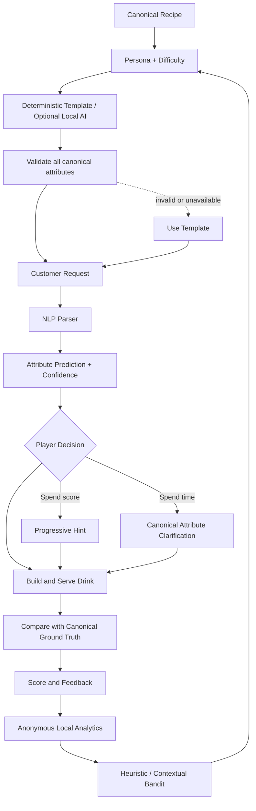

# AI System Flow

The parser prediction never replaces canonical ground truth. Hints and clarification read canonical values, and evaluation scores the submitted drink against those values. Generation is optional and does not use a cloud service.
