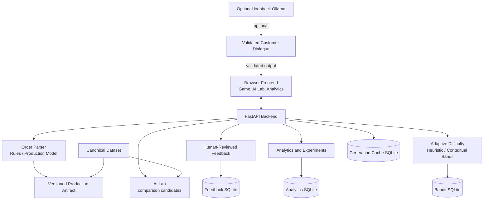

# BrewAI Architecture

The browser owns round and shift interaction. The API predicts attributes independently and evaluates player submissions against canonical ground truth. SQLite is local and separated by concern. The production model, AI Lab comparison models, and human-feedback candidates have separate artifacts/provenance; candidates are not automatically promoted. Optional customer generation receives canonical attributes and must pass validation before use.
